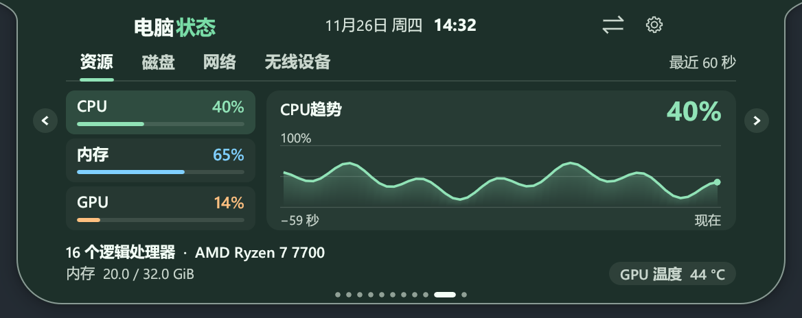
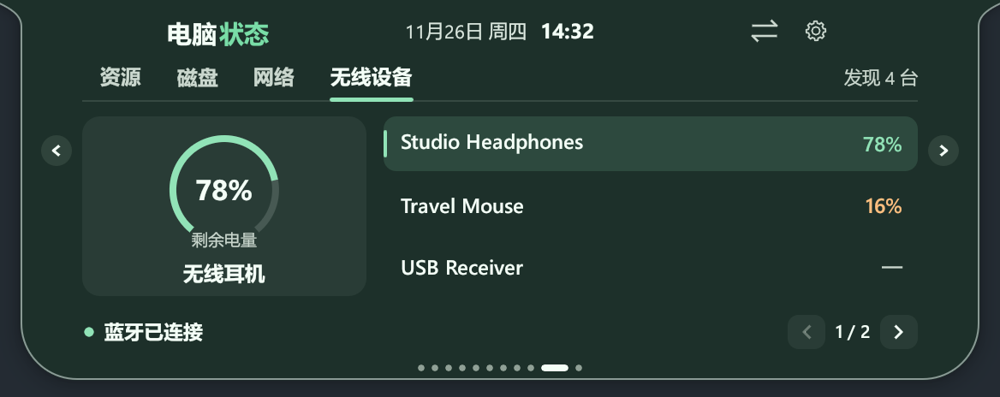

# 岛蛋 Daodan

岛蛋是一款 Windows 64 位桌面工具。把鼠标移到屏幕顶部，可以展开岛体查看电脑状态、无线设备电量和剪贴板。移到屏幕边缘，可以从半圆形工具环快速截图、录屏或转换文件。

## 下载与安装

[前往最新版本下载](https://github.com/Chris-arui/Daodan/releases/latest)，展开 **Assets**（下载附件），按需要选择一个 ZIP。

| 版本 | 适合谁 | 怎么识别 |
| --- | --- | --- |
| 轻量版 | 想先体验岛蛋，之后再按需安装文件转换组件 | 文件名以 `-win-x64-lite.zip` 结尾 |
| 完整版 | 经常转换文档，希望安装时一并装好扩展转换组件 | 文件名以 `-win-x64.zip` 结尾 |

完整解压 ZIP，双击 **安装岛蛋.exe**。已安装的用户可在 **设置 → 关于 → 检查更新** 中升级。

## 可以做什么

- **截图和录屏**　框选区域后，可以标注、打马赛克、识别文字，也可以截滚动长图、录 GIF 或视频。
- **文件暂存和转换**　把文件拖到岛体文件页左侧可暂存，拖到右侧或屏幕边缘的小条可转换。转换结果保存在原文件旁边。
- **剪贴板和翻译**　搜索最近的 100 条剪贴板记录，或打开翻译页进行中英翻译。
- **电脑状态**　从圆环点「性能」，用柱状图比较 CPU、内存和 GPU 占用，点选指标可看最近一分钟的变化。磁盘和网络各有独立视图。
- **无线设备**　从圆环点「无线」，查看已连接的蓝牙外设、设备上报的剩余电量，以及 USB 无线接收器的插入状态。

## 界面预览

两张预览使用示例数据。实际可显示的温度和电量取决于硬件及驱动。
